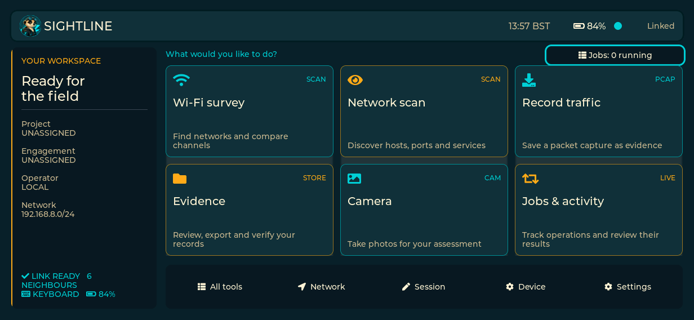
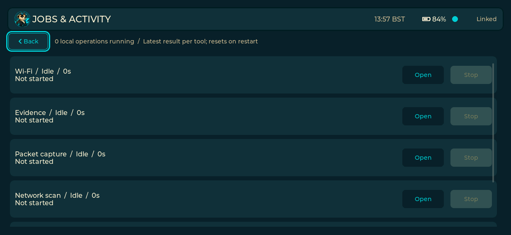
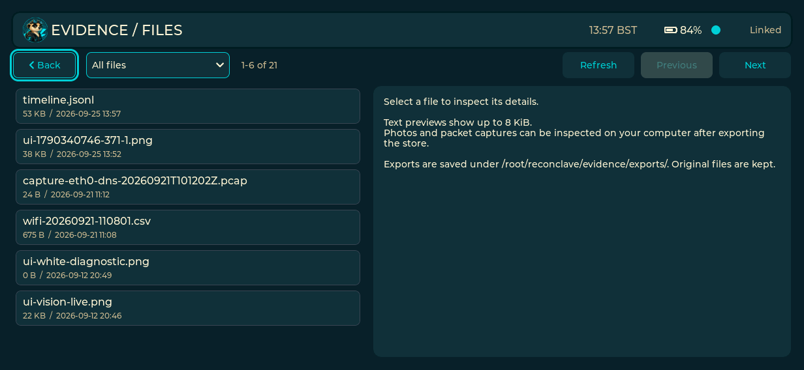

# On-board validation — 2026-09-25

The UI and capture/scan wrappers were deployed to the K230 discovered at
`192.168.8.134`, advertising `rc-k230-poc.local`. The protocol node service was
left running. The installed pre-overhaul UI and wrappers were preserved with
`.before-overhaul` suffixes; see the operator guide for rollback instructions.

## Automated checks

- Host regression suite: passed.
- Evidence tests: bounded previews, archive format/interoperability, exact-byte
  SHA-256 verification, cancellation, changed-file rejection, session attribution,
  session-only selection and job lifecycle transitions passed.
- Tool-wrapper lifecycle suite: successful completion, failure, cancellation,
  partial-report publication and child-process cleanup passed using simulated
  executables, without generating network assessment traffic.
- Headless LVGL navigation suite: nested Back behavior, refreshed controls,
  hidden/disabled controls, dropdown focus and focus retention passed.
- RISC-V UI cross-build and whitespace checks: passed.

## Device checks

- UI restarted cleanly; runtime reports keyboard ready and battery telemetry.
- Examined framebuffer screenshots of Home, Jobs, Evidence and the file browser.
  Corrected default button shadows, logo/title spacing, dropdown styling and
  Jobs scrollbar clearance found during this check.
- Captured a screenshot through the UI's command-file path. The operation reached
  Completed and produced session metadata for the resulting PNG.
- Exported the current session through the UI. The archive contained that one
  attributed PNG and excluded the older, unattributed artifacts in the store.
- Retrieved the archive to the workstation and independently verified the TAR,
  stored SHA-256, byte count and matching context using Python's standard library.
- Exercised the installed capture and Nmap wrappers under the device's own shell
  using a small simulated RISC-V tool executable. Both cancellation paths returned
  130 and reaped their tool child. Test fixtures were confined to `/tmp` and
  removed after the checks; no network capture or scan was launched.
- Final installed UI and wrapper hashes were compared with the local outputs.
  The device was left on Home with the UI and node services running.

## Limits

These checks verify real rendering and the tested software paths. They do not
substitute for physical touch/keyboard acceptance, real scan/capture cancellation
under load, long battery runs, GNSS acquisition or camera capture testing. Existing
hardware validation history is recorded separately in `DEVELOPMENT.md`.

Job history is in memory and resets on UI restart. Session matching uses the
exact project, engagement and operator triple, not a unique session UUID. Legacy
and remote-created artifacts without supported sidecars remain unattributed.

## Screenshots

## Assessment workspace follow-up — 2026-09-25

Built and deployed the Assets workflow to the K230. Host tests pass, including
new inventory query checks (numeric IPv4 ordering, case-insensitive software/MAC
search, combined filters, service-only ports, recent ordering and empty input).
The existing headless navigation suite passes. Cross-compilation of the UI and
node succeeds with the device toolchain; only the UI binary was deployed in this
increment, preserving the running node service and its stored observations.

On-board screenshots verified the home layout and Assets search after correcting
default LVGL control padding and colours. A search reduced the live inventory to
the expected single asset. The real export action wrote a JSON inventory, which
was downloaded and checked for schema, device-history scope, partial coverage,
asset count and findings structure. These are read-only UI/data-path checks; no
new network scan was launched for acceptance.

Private screenshots are retained locally under
`assessments/ui-overhaul-2026-09-25/` rather than checked into the public docs.
The rollback binary is `/root/reconclave/backups/ui-before-assets-20260925`.
Physical touch typing, every dropdown interaction and the hardware keyboard's
complete edit workflow still require operator acceptance; screenshot review does
not establish those behaviours. Nmap XML import, assessment-isolated asset stores
and durable unified job history remain unimplemented.

## NSE-style protocol checks — 2026-09-29

The bounded assessment script was deployed to the Sightline unit at
`192.168.8.140`; its installed SHA-256 matched the source. All seven host
tests passed, including local HTTP-header, SMB2-negotiate and certificate
fixtures. A scoped check of `192.168.8.0/24` found TCP/445 on `.239`; the
new probe reported SMB 3.0.2 with signing enabled but not required. A live
HTTPS probe of `.2` returned TLS 1.3, certificate subject and expiry, and an
HTTP response header. Both probes were bound to `eth0` and its source address.
The earlier `.238` SMB target refused connections during this validation.

These checks are read-only observations and do not establish a vulnerability
or certificate trust. At this point, the full staged ASSESS workflow had not
been repeated after this script update; see the native NSE validation below.

## Native NSE runtime — 2026-09-29

The pinned Buildroot Nmap recipe now builds Nmap 7.95 with its bundled Lua
5.4.6 runtime and installs the NSE scripts, database and libraries. The new
binary and data files were deployed to Sightline. `nmap --version` reports
`nmap-liblua-5.4.6`, and `--script-help smb2-security-mode` loads the script.
The bounded wrapper completed native `smb2-security-mode` against `.239` and
HTTP/TLS scripts against `.2` over Ethernet, saving text and XML evidence.
The XML parser extracted the SMB signing result. All seven host tests passed.

ASSESS now plans a fixed set of five safe NSE scripts against observed open
ports, capped at 16 hosts and 64 ports per host. A complete staged assessment
of `192.168.8.239/32` ran over `eth0`: one host, seven service ports, four
direct protocol checks and one native NSE host check. Its summary included
four NSE script observations, zero skipped checks and no warnings. The full
`192.168.8.0/24` workflow has not been repeated with NSE enabled.

## Full-scope field run — 2026-09-29

The authorised `192.168.8.0/24` assessment on Ethernet found 45 responding
hosts, 24 hosts with open TCP ports and six response-confirmed open UDP ports.
It recorded 45 direct protocol checks and attempted the native NSE stage on
16 hosts. The initial summary marked the run partial because its 16-host NSE
cap left four eligible hosts untested; those four were subsequently checked
with the same bounded wrapper and saved separately.

Evidence review found three focused scans where Nmap exited zero after a
per-host timeout. The initial summary incorrectly counted their nine ports as
checked. The assessment script now treats those results as skipped and records
the warning. A native HTTP script also returned an empty output with a `Bug in`
message while Nmap exited zero; the script now records that message as a
warning. NSE observations now include their source port, and the NSE host cap
is 24 while the overall 15-minute deadline remains in force. Host fixtures
cover timeout accounting and NSE result parsing. The full subnet was not
rescanned after these corrections.

## Field toolkit follow-up — 2026-10-08

All eight host regression tests, the headless UI test and the standalone RISC-V
cross-build pass. The mission lifecycle fixture checks JSON, Markdown and CSV
handoffs from one completed result. The full 600 MiB-rootfs Buildroot image
also built successfully in an isolated copy of the pinned K230 SDK. `e2fsck
-fn` found no rootfs errors; the image contains `dig`, `host`, `jq`, Nmap and
the installed Sightline services. QEMU loaded the image's `dig` 9.18.33 and
`jq` 1.7.1. An initial image build exposed a missing BIND runtime dependency;
the recipe now includes `jemalloc`, and the rebuilt image contains it.
The compressed image is at
`.toolchains/k230_linux_sdk/output/k230_canmv_t_display_rm69a10_defconfig/images/sysimage-sdcard.img.gz`
with SHA-256 `e902457e4a4b4dfc3409af4fd9e48e7adf851c33924145ffed51578df5eac8fb`.

The device was subsequently discovered at `192.168.8.136` on Wi-Fi and
`192.168.8.134` on USB Ethernet. Before changes, it reported Buildroot
2025.02.1, kernel 6.6.36, about 900 MiB available RAM and 181 MiB free
rootfs space. Its `wlan0` uses the `rtl8189fs` SDIO driver and `eth0` the
`r8152` USB driver. Existing UI and scripts were backed up under
`/root/reconclave/backups/field-toolkit-20261008T083614Z`. The new UI and
scripts were installed; hashes matched local outputs, keyboard-ready and
battery telemetry appeared in the live log, and a DRM screenshot showed the
new Device info toolkit panel with readable layout. An isolated report fixture
passed on the K230's own Python runtime. The new DNS/JSON binaries and their
libraries were installed from the built image after staging tests: `dig`
resolved `example.com` through the local router and `jq` parsed the live
capability inventory. Free rootfs space afterward was 174 MiB.

The device stopped responding on both network interfaces during a final
screenshot transfer. Its display/power state had not been confirmed at the
time of this note. This follow-up does not establish a stable end-to-end run,
physical keyboard text editing, Wi-Fi monitor/injection, or USB gadget mode.
